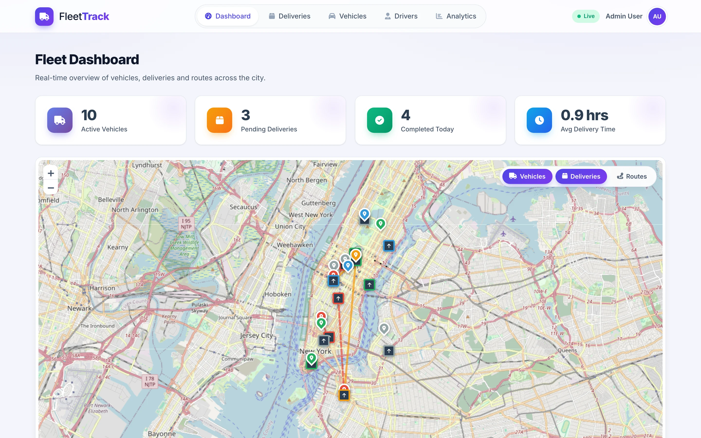
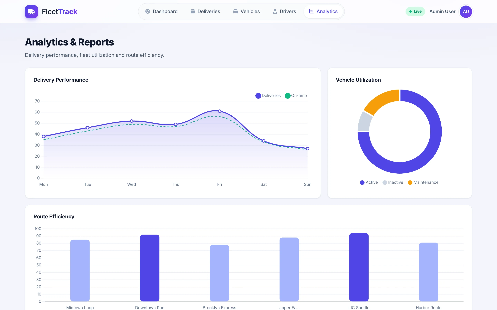
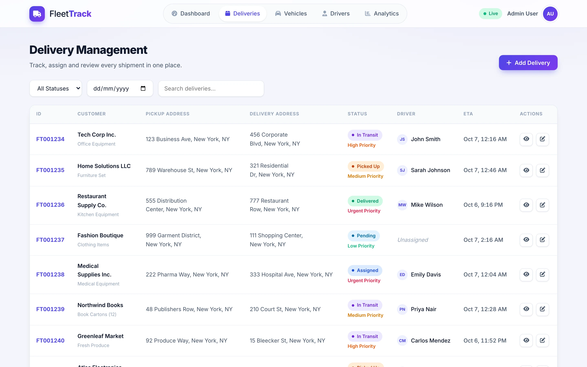
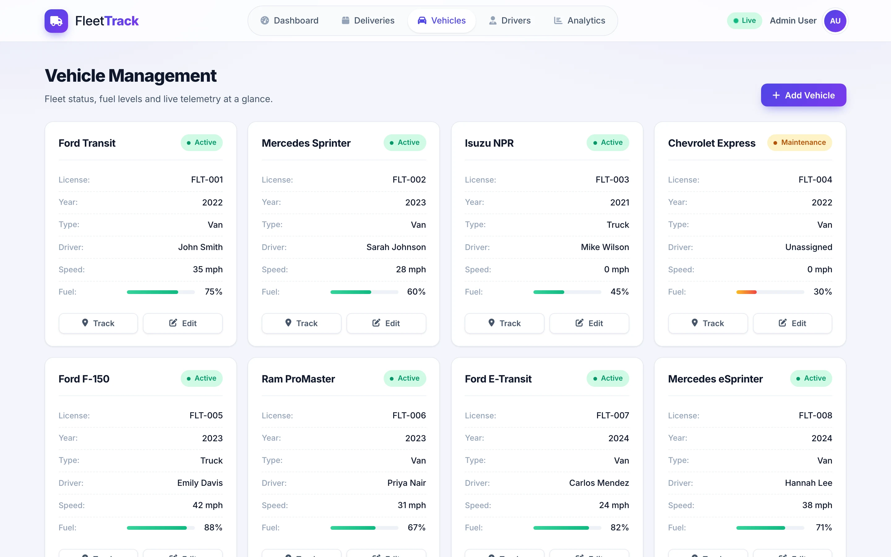
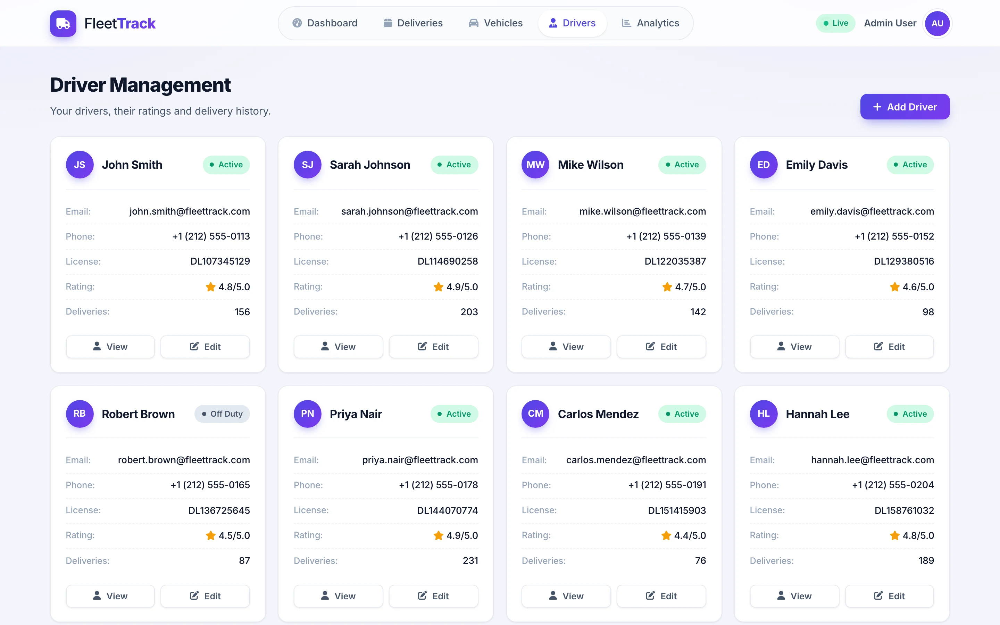

# Fleet-Track

**A courier and fleet dashboard concept: map, deliveries, vehicles, drivers and analytics in one single-page interface.**

Vanilla JavaScript · Leaflet · Chart.js · Node/Express · Socket.IO · PostgreSQL (reference backend)

<table>
  <tr>
    <td></td>
    <td></td>
  </tr>
</table>
Screenshots are real captures of a local build running on fictional demo data.

---

## Product at a Glance

| | |
|---|---|
| **What it is** | Dispatcher-style dashboard for tracking vehicles, deliveries and drivers |
| **Platform** | Desktop web, single-page app |
| **Views** | Dashboard, Deliveries, Vehicles, Drivers, Analytics |
| **Map** | Leaflet with OpenStreetMap tiles, vehicle and delivery markers, route lines, layer toggles |
| **Charts** | Chart.js line, doughnut and bar charts |
| **Data in this build** | Fictional in-browser mock data (no backend required) |
| **Backend** | Express + Sequelize/PostgreSQL + Socket.IO reference implementation, not wired to the UI |

## Product Showcase

<table>
  <tr>
    <td align="center"> <b>Deliveries</b> Status, priority, driver, ETA</td>
    <td align="center"> <b>Vehicles</b> Status, driver, speed, fuel</td>
    <td align="center"> <b>Drivers</b> Contact, rating, deliveries</td>
  </tr>
</table>

## Key Features

- KPI cards: active vehicles, pending deliveries, completed today, average delivery time
- Interactive map with vehicle and delivery markers, route lines and layer toggles
- Delivery table with status and priority badges, status filter, date filter and search
- Vehicle cards with status, assigned driver, speed and fuel level
- Driver cards with contact details, rating and delivery counts
- Analytics: weekly delivery volume vs on-time, vehicle utilization, route efficiency

## Architecture

- **Frontend (`public/`):** vanilla JS modules per section (`app.js`, `map.js`, `deliveries.js`, `vehicles.js`, `drivers.js`, `analytics.js`), Leaflet and Chart.js from CDN.
- **Demo data:** mock providers in `app.js` feed every screen; nothing is persisted.
- **Backend (reference):** Express routes, Sequelize models (User, Vehicle, Driver, Customer, Delivery, Route, TrackingUpdate), JWT role middleware, Socket.IO delivery rooms, Twilio SMS and route services.
- **Packaging:** Docker/compose files, Jest and Cypress configuration.

Details: [docs/ARCHITECTURE.md](docs/ARCHITECTURE.md)

## Engineering Highlights

- Section-based SPA with lazy map resize/fit and chart initialization when a view is first shown
- Domain model covering vehicles, drivers, customers, deliveries, routes and tracking updates
- Per-delivery Socket.IO rooms to scope location updates (backend)
- Role-checking middleware (admin, manager, dispatcher, driver) (backend)
- Optional integrations (SMS, directions API) disable themselves when credentials are absent, with a nearest-neighbor route fallback (backend)
- Mock-first UI with relative timestamps so the demo works without any infrastructure

## Status & Scope

- The UI in the screenshots runs entirely on fictional mock data. It does not call the backend, so there is no live tracking, persistence or login in this build.
- The backend is a reference implementation that was not runnable as shipped (missing modules, wrong static directory, incomplete seed script) and needs PostgreSQL to run. Its real-time, SMS and analytics features were not exercised.
- Route "optimization" is a simple heuristic, not ML. There is no AI in the project.
- The demo needs internet access for map tiles and CDN assets.
- Portfolio changes to the demo: charts render on the Analytics page, average delivery time shown in hours, map resize/fit, a visual polish layer and enriched fictional data.

## Documentation

- [Product overview](docs/PRODUCT_OVERVIEW.md)
- [Architecture](docs/ARCHITECTURE.md)
- [Engineering notes](docs/ENGINEERING_CHALLENGES.md)
- [Technical case study](docs/TECHNICAL_CASE_STUDY.md)
- [Privacy and source](docs/PRIVACY_AND_SOURCE.md)

## Rights

See [RIGHTS.md](RIGHTS.md).
