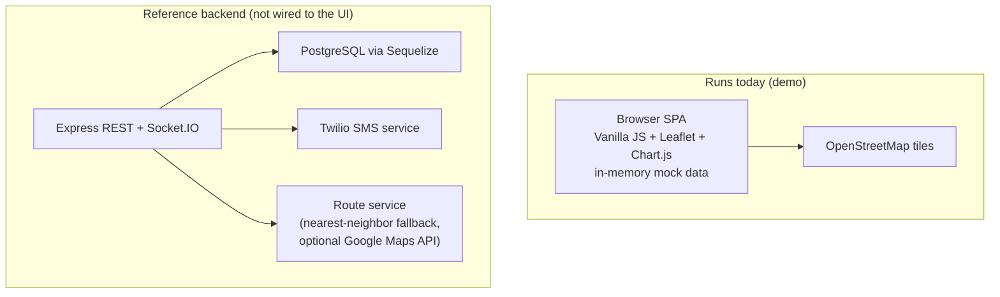

# Fleet-Track: Architecture

> **Scope note:** The UI shown in the screenshots runs entirely on fictional in-browser mock data (`getMock*` functions in `public/js/app.js`). It does not call the backend. The backend described below is a reference implementation that was not runnable as shipped.

## Two Layers

## Frontend (`public/`)

- `index.html` — single entry point, five sections (Dashboard, Deliveries, Vehicles, Drivers, Analytics)
- `js/app.js` — navigation, dashboard KPIs, mock data providers, toasts/loading states
- `js/map.js` — Leaflet map, vehicle/delivery markers, route polylines, layer toggles
- `js/deliveries.js`, `js/vehicles.js`, `js/drivers.js` — section managers
- `js/analytics.js` — Chart.js charts (line, doughnut, bar) fed by mock numbers
- `css/styles.css`, `css/premium.css` — layout and design tokens

## Backend (reference, not runnable as shipped)

- **Models (Sequelize):** User, Vehicle, Driver, Customer, Delivery, Route, TrackingUpdate
- **Routes:** auth, vehicles, drivers, deliveries, tracking, analytics
- **Auth middleware:** JWT verification with role checks (admin / manager / dispatcher / driver)
- **Socket.IO:** clients join a `delivery-<id>` room and receive `location-updated` events
- **Services:** `smsService` (Twilio, disabled unless credentials exist) and `routeService` (geocoding/directions via an external API when a key is configured, otherwise a haversine nearest-neighbor ordering)
- **Hardening:** helmet and express-rate-limit on `/api/`; winston logging
- **Tooling:** Dockerfile and compose files, Jest and Cypress configuration, one API test file

Known gaps in the shipped backend: it serves a `frontend/` directory that does not exist (the UI lives in `public/`), some route files import modules that are missing, and the seed script is incomplete. Making it run would take fixes plus a PostgreSQL instance.
